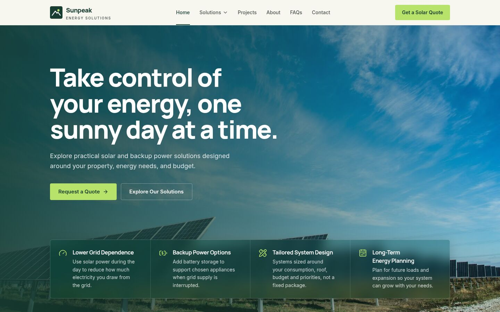
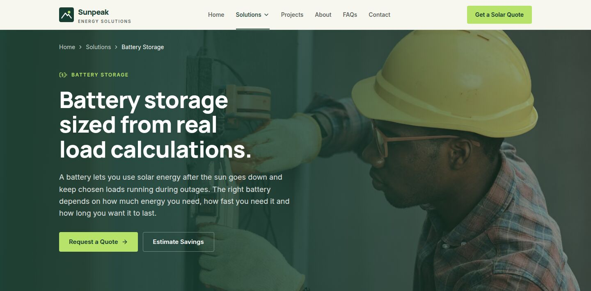
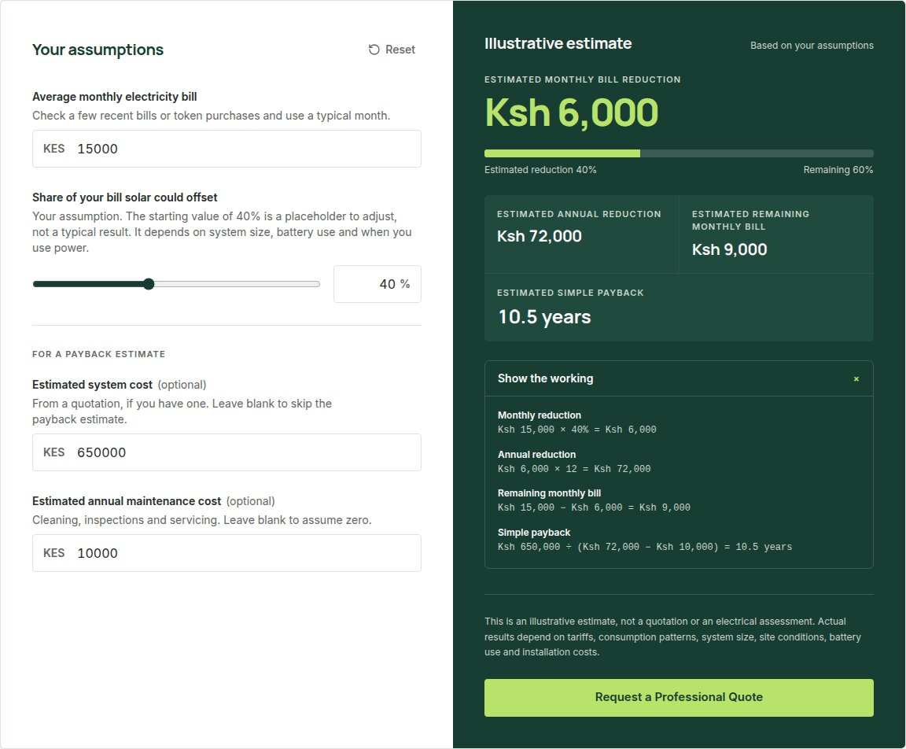
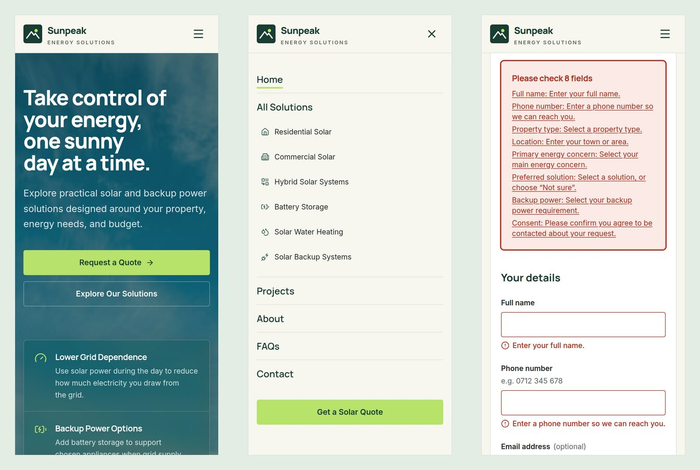
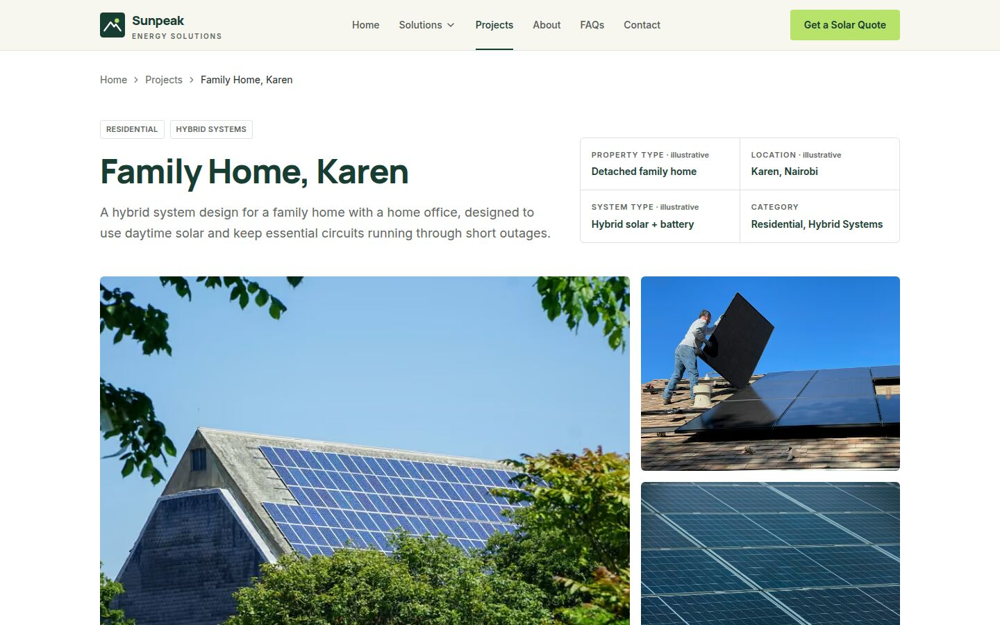

# Sunpeak Energy Solutions: Case Study

**A marketing and lead-generation website for a fictional Kenyan solar company.**

- **Live site:** [sunpeak.belion.co.ke](https://sunpeak.belion.co.ke)
- **Source:** [github.com/TallamGilbert/sunpeak](https://github.com/TallamGilbert/sunpeak)
- **Stack:** Next.js 16 (App Router, Cache Components) · TypeScript · Tailwind CSS v4 · lucide-react · Vercel

---

## The brief

Sunpeak helps homeowners and businesses in Kenya adopt solar power: rooftop systems, battery storage, backup power and solar water heating. The site had to explain those options to non-technical visitors and turn interest into consultation requests.

It had to feel **premium, technical and trustworthy** without looking like a software dashboard or a generic "green energy" template. Because Sunpeak is fictional, it also had a firm constraint: **no invented proof.** That meant no fake reviews, client logos, certifications, installation counts or savings claims.

That constraint shaped the whole project. Most solar sites lean on testimonials and big numbers. This one had to build trust through clarity instead, explaining how things work, showing its reasoning and being upfront about what an estimate can and can't tell you.

## What was built

- **24 pages plus a 404 page**, all prerendered: Home, About, a Solutions overview with six solution pages, a Projects portfolio with eight project pages, a Solar Savings Calculator, FAQs, Contact, Request a Quote, Privacy Policy and Image Credits.
- **An interactive savings calculator** with transparent, unit-tested formulas.
- **Two lead forms** (quote and contact), validated in the browser and again on the server, with a working delivery path to a webhook or CRM.
- **A filterable project portfolio**, with each project written as a realistic design scenario.
- **SEO groundwork:** page-specific metadata, canonical URLs, a branded Open Graph image, a sitemap and robots rules.

## Design

### Visual direction

The palette is a deep forest green (`#183D32`) for authority, a solar lime (`#B7E36B`) used sparingly for calls to action, and warm off-white and sage surfaces. Headings use Manrope and body text uses Inter. Corners are small, borders and shadows restrained, and gradients appear only where they do a job, such as keeping text readable over a photograph.

All colours, radii, shadows and fonts are defined once as Tailwind v4 theme tokens. Every component draws from the same set, which kept the design consistent as it evolved.

### Photography-led headers

Early versions used split layouts with text on one side and a photo on the other. As the site matured, every primary page moved to a **full-bleed photographic header**: the photo fills the header, with a forest-green tint that is strongest behind the text and fades out on the image side.

Making that work across 16 different photos needed a small image system:

- **Per-image focal points.** Each photo stores an `object-position`, so every crop keeps the subject in frame, whether it's a 16:10 card, a 4:3 gallery tile or a wide header.
- **Background-specific framing.** Wide headers crop the top and bottom of a photo, not the sides, so subjects can't be moved sideways. Photos with the subject on the left are mirrored for header use, so the subject sits beside the headline rather than behind it. This is only done on photos that contain no text.
- **One shared header component.** Inner pages use one `PageHero` component, which takes an optional photo. Utility pages such as Privacy Policy keep a plain version.

### Glass benefits strip

On the homepage, the four key benefits sit in a frosted-glass panel along the bottom of the hero photo. The panel uses a translucent tint, background blur and a hairline border. The hero fills the screen below the header, so the first view is complete without the next section peeking in.

### Contrast as a design input

The brief's secondary grey (`#707873`) measured **4.22:1** on the off-white background and **3.79:1** on sage, below the WCAG AA minimum of 4.5:1 for body text. It was kept for icons and dividers, and secondary text uses a slightly darker `#5F6762` instead, which passes on every surface.

The same discipline applied to the subtle solar-panel texture behind the homepage savings section. Its tint was raised in steps while the real rendered pixels behind the text were measured, until the darkest areas reached about 4.5:1. That set the upper limit on how visible the texture could be.

## Engineering highlights

### A calculator built to be trusted

The calculator logic lives in its own module, separate from the interface, and is covered by unit tests:

| Output | Formula |
|---|---|
| Monthly reduction | monthly bill × assumed offset % |
| Annual reduction | monthly reduction × 12 |
| Remaining bill | monthly bill − monthly reduction |
| Simple payback | system cost ÷ (annual reduction − annual maintenance) |

If maintenance costs equal or exceed the annual saving, the calculator does not show a misleading number. It explains that a positive payback period can't be calculated from those assumptions.

A **"Show the working"** panel substitutes the visitor's own figures into each formula. The offset slider's starting value is labelled as a placeholder to adjust, not a typical result. Inputs accept everyday formats such as `12,500` or `KES 8,000`, reject negative and out-of-range values, and format results in Kenyan shillings.

### Lead forms with honest outcomes

Both forms share one validation module, used in the browser for instant feedback and again in a server action, because server input can't be trusted. Kenyan phone formats (`07…`, `01…`, `+254…`, landlines) and international numbers are accepted.

When submission fails validation, an **error summary** receives focus and links to each problem field, and each field announces its error to screen readers.

Delivery is controlled by one environment variable:

- **With `LEAD_WEBHOOK_URL` set:** the validated submission is posted as JSON, and the visitor gets a reference number. Network failures show a clear error state.
- **Without it:** the form runs in **demo mode** and says so plainly. Nothing is sent or stored, and the visitor is told that.

Both paths were tested end to end against a local webhook receiver, including the failure case.

### Working with Next.js 16 Cache Components

This version of Next.js keeps recently visited pages mounted but hidden, so their state is preserved. That's great for forms, but it produced some subtle bugs that had to be designed around:

- Menus and dropdowns close when the route changes, including on back and forward navigation, so the visitor never returns to an open menu.
- A finished form submission resets when the visitor leaves the page, so they don't come back to a stale "thank you" message.
- The solution and project pages got a Suspense boundary, via a `loading.tsx` file, after development tooling flagged that they could slow down navigation.

### Bugs worth mentioning

- **The mobile menu couldn't be tapped.** The sticky header used `backdrop-filter`, which turns the header into the containing block for fixed-position children. The full-screen menu panel collapsed to the header's height, and taps passed through to the page behind. The fix was to give the header a solid background.
- **A CSS ordering conflict.** A button's base `inline-flex` class was overriding `hidden`, so the header's call-to-action button still showed on phones and caused horizontal scrolling. A breakpoint-specific class, which takes precedence, fixed it.
- **Missing share images.** Inner pages that defined their own Open Graph data were silently dropping the inherited share image. It's now set explicitly everywhere.

## Content and integrity

Every project is written as a **design scenario**: the challenge, the proposed system, the components, the installation considerations and the outcome the design is intended to achieve. System sizes are marked as illustrative. Outcomes are phrased as design intent, not measured results.

The solution pages are deliberately careful with claims. Backup duration depends on battery capacity and connected loads. A backup system is not the same as powering a whole home. Savings depend on tariffs, usage and site conditions. Each page says these things plainly instead of promising performance.

Contact details use a reserved `.example` email domain and a masked phone number, and no office address or map is shown. The footer on every page states that the company and its content are fictional. Photography is stock imagery with sources and licences listed on the Image Credits page. One photo whose licence requires attribution is credited accordingly. Two photos that showed a real solar company's own installations were rejected, as was one that showed a real brand name.

## Quality checks

- **26 unit tests** covering calculator formulas, edge cases, input parsing and form validation, run with Node's built-in test runner.
- **About 30 automated browser checks** with Playwright: calculator results and edge cases, form validation and focus management, demo-mode results, dropdown and mobile-menu behaviour, project filters, the skip link and every internal link. These run against both the local production build and the live Vercel deployment.
- **Visual review** of every page at widths from 320px to 1920px, with automated checks for console errors and horizontal scrolling.
- TypeScript, ESLint and the production build run cleanly before every deploy.

## Delivery

The code is on GitHub. The Vercel project is connected to the repository, so every push to `main` deploys automatically. The site is served on a custom subdomain, with the DNS record on Cloudflare pointing to Vercel. Canonical URLs, the sitemap and social previews all use the production domain.

## What I'd add next

- **A backup and load calculator.** Visitors pick appliances and hours of use to get an estimate of daily energy use, peak load and rough battery size. Many visitors arrive with an outage problem rather than a bill problem.
- **WhatsApp and a sticky mobile action bar**, matching how people in Kenya commonly contact service businesses.
- **A payment options page** covering M-Pesa, instalments and pay-as-you-go, in general terms with no invented partners.
- **A multi-step quote form** with a progress bar, to help more visitors finish it.
